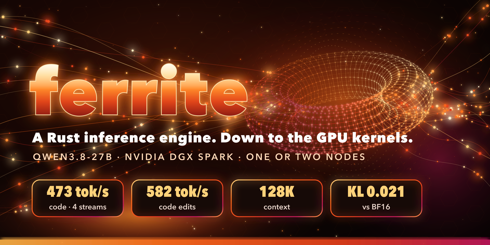
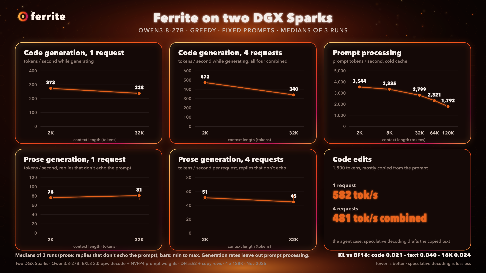

<p align="center"></p>

# Ferrite

Ferrite is an LLM inference engine for **NVIDIA DGX Spark** (GB10), written in Rust from the HTTP server down to the
GPU kernels. The kernels are Rust too: compiled by rustc's `nvptx64-nvidia-cuda` backend to PTX, assembled for
`sm_121a`, and launched through a thin binding to the CUDA driver. Ferrite serves **Qwen3.8-27B** on one Spark or
across two connected over RoCE, behind an OpenAI-compatible API with streaming, thinking, tool calls, a prompt cache
and 128K context.

An experimental second target serves the same model on one **Intel Arc Pro B70**, with Rust kernels compiled to
SPIR-V and loaded through Level Zero: see [Intel Arc Pro B70](#intel-arc-pro-b70).
The same CUDA engine also runs on one **RTX 5080** (16 GB) with a quantized K/V cache and the prompt weights
streamed from host memory: see [docs/rtx-5080.md](docs/rtx-5080.md).

> **Status: experimental.** One model (Qwen3.8-27B), one GPU (GB10 / `sm_121a`). At most 4 requests run at once
> with DFlash2 drafting; more wait in a queue. It works, but expect rough edges. Issues and measurements from other
> Sparks are welcome.

## Supported systems

**Linux only.** macOS and Windows are not supported.

| Target | Operating system | CPU | GPU and driver | How you get it |
|---|---|---|---|---|
| NVIDIA DGX Spark, one or two | DGX OS (Ubuntu 24.04) | aarch64 | GB10, NVIDIA driver 580+, CUDA 13 | Prebuilt package, or from source |
| NVIDIA RTX 5080 (experimental) | Linux; tested on Ubuntu 24.04 | x86_64 | 16 GB, NVIDIA driver 595, CUDA 13 toolkit | From source: [docs/rtx-5080.md](docs/rtx-5080.md) |
| Intel Arc Pro B70 (experimental) | Linux with the `xe` kernel driver; tested on Arch Linux | x86_64 | 32 GB, Level Zero loader 1.32+ | From source: [docs/arc-b70.md](docs/arc-b70.md) |

## Why Ferrite exists

Ferrite started as an experiment by a [TensorFold](https://github.com/ashhart/TensorFold) contributor: how far down the
stack can Rust go in a real inference engine, all the way into the GPU kernels, and what does it cost? Much of what
makes Ferrite work was learned from TensorFold and exllamav3 first (see [Credits](#credits)). If you want a mature
engine that serves many models, use TensorFold. Ferrite is a focused, single-model look at the Rust question.

## Results

Two DGX Sparks connected over RoCE, Qwen3.8-27B, greedy decoding, fixed prompts. Medians of 3-5 runs, in tokens per
second. Generation figures are tokens per second while generating; prompt processing is listed separately. End-to-end
figures that include the time to the first token are in [docs/benchmarks.md](docs/benchmarks.md#results).

| | Ferrite |
|---|---|
| Code, 4 requests (aggregate) | 473 |
| Code, 1 request | 273 |
| Code, 1 request, 32K context | 238 |
| Code edits, 1 request (rewrite a file it was shown) | 582 |
| Code edits, 4 requests (aggregate) | 481 |
| Prose, 1 request | 76 |
| Prompt processing, 2K / 32K context | ~3,550 / ~2,800 |
| KL divergence vs BF16 (code / text / 16K context), lower is better | 0.021 / 0.040 / 0.024 |

<p align="center"></p>

How these were measured, and what they leave out, is in [docs/benchmarks.md](docs/benchmarks.md). In short:
- Speculative decoding speed depends on the text. Code and edits are faster than prose.
- The prose figure counts only replies that don't fall into echoing the prompt, which the standard benchmark prose
  prompt tends to cause.

### Agents and the prompt cache

Coding agents resend the whole conversation every turn, and several agents often share one long system prompt.
Ferrite's prompt cache snapshots each conversation at turn boundaries and resumes from the longest match. A
conversation that loses its slot is parked in a memory pool, and a shared system prompt is computed once. A resumed
reply is the same, token for token, as one computed in full. The cache is on by default; `FERRITE_CACHE=0` turns it off.
Its pool is 12 GB on one Spark and 24 GB on each of two (`FERRITE_PARK_GB` overrides), and it shrinks if needed to keep
20 GB of memory available.

Four agents at once on two Sparks, sharing a ~13K-token system prompt (`tools/bench/agents.py`, 2-3 turns each),
with the cache on instead of off:
- prompt tokens computed: 74% fewer (86% fewer with thinking on);
- time to the first token on the first turn: 16.4 s to 5.1 s; on later turns about 0.4-0.6 s;
- combined output over the run: 46.5 to 92 tok/s (thinking on: 36.9 to 108 tok/s).

How it works and its limits: [docs/prompt-cache.md](docs/prompt-cache.md).

## Quick start

Requirements: a DGX Spark (GB10) with DGX OS, NVIDIA driver 580+, at least 95 GB of available memory and 38 GB of
disk.

**One command**, from a fresh Spark to a running server. It checks the machine first, needs no `sudo`, and can be run
again (finished steps are skipped):

```bash
curl -fsSL https://raw.githubusercontent.com/BHCC2025/ferrite/main/scripts/install.sh | bash
```

It installs Ferrite into `~/ferrite` (`FERRITE_HOME`) and the models into `/var/tmp/models` (`FERRITE_MODELS`), starts
the server in the background (log `~/ferrite/logs/server.log`, stop with `kill -- -$(cat ~/ferrite/logs/server.pid)`) and sends it a test
request. `--no-serve` stops after the models, `--source` builds from source.

> **Install with your AI agent.** Paste this into your coding agent on the Spark:
>
> `Install Ferrite on this DGX Spark by following https://github.com/BHCC2025/ferrite/blob/main/AGENTS.md exactly; stop and ask me if any check fails.`

**Step by step** from the release tarball (no Rust or CUDA toolchain needed):

```bash
# 1. unpack the release
tar xzf ferrite-<version>-dgx-spark-aarch64.tar.gz && cd ferrite-<version>-dgx-spark-aarch64
scripts/check-deps.sh

# 2. download the models (about 38 GB) into $FERRITE_MODELS
export FERRITE_MODELS=$HOME/models
scripts/fetch-models.sh

# 3. serve an OpenAI-compatible API on :8000 (model id "qwen3.8-27b")
scripts/serve.sh
curl -s localhost:8000/v1/models
```

Point any OpenAI-compatible client at `http://<spark>:8000/v1`: Open WebUI, Continue, Cline and other coding agents.
Details, the two-Spark setup and troubleshooting are in [docs/quickstart.md](docs/quickstart.md) and [TP2.md](TP2.md).

### Models

| Role | Repository | License |
|---|---|---|
| Decode weights: EXL3 mixed 3.0 bpw (5-bit head) | [`BHCC2025/Qwen3.8-27B-EXL3-3.0bpw-mix`](docs/model-card.md) | Apache-2.0 |
| Prompt weights: NVFP4/FP8 (optional) | [`nvidia/Qwen3.8-27B-NVFP4`](https://huggingface.co/nvidia/Qwen3.8-27B-NVFP4) | Apache-2.0 |
| Draft model: DFlash2 | [`z-lab/Qwen3.8-27B-DFlash2`](https://huggingface.co/z-lab/Qwen3.8-27B-DFlash2) | Apache-2.0 |

All three derive from [Qwen/Qwen3.8-27B](https://huggingface.co/Qwen/Qwen3.8-27B) (Apache-2.0). Without the NVIDIA
checkpoint, Ferrite processes prompts with bf16 weights rebuilt from the EXL3 quant. That runs at about half the
prompt speed, uses more memory, and defaults to 32K context.

### Configuration

Everything has a default; set only what differs on your machines. `tools/site.sh` prints the resolved settings.

| Variable | Default | What it sets |
|---|---|---|
| `FERRITE_MODELS` | `/var/tmp/models` | Folder holding the three model folders |
| `FERRITE_EXL3_DIR` / `FERRITE_NVFP4_DIR` / `FERRITE_DRAFT_DIR` | under `$FERRITE_MODELS` | Each model folder, if stored elsewhere |
| `FERRITE_MODEL_ID` | `qwen3.8-27b` | Model id the API reports |
| `FERRITE_PORT`, `FERRITE_CTX`, `FERRITE_SLOTS` | `8000`, `131072`, `4` | Port, context per request, requests at once (at most 4 with DFlash2) |
| `FERRITE_STATE_DIR` | `/var/tmp/ferrite` | Logs, run files and locks |
| `FERRITE_PEER` | none | Second Spark's ssh host (required in two-node mode) |
| `FERRITE_FABRIC` | unset | `auto` detects the RoCE devices, interface and GID shared with the peer; the two-node scripts do this whenever `FERRITE_TP_HOST` is unset |
| `FERRITE_TP_HOST`, `FERRITE_NET_IF`, `FERRITE_ROCE_HCA`, `FERRITE_ROCE_GID` | see TP2.md | Manual two-node fabric settings |

## Intel Arc Pro B70

Ferrite also runs on a single Intel Arc Pro B70 (32 GB): the same model and server, a separate engine
(`fe-server --engine xe`) whose kernels are Rust compiled to SPIR-V. It is experimental, serves one request at a time
(up to four with `FERRITE_SLOTS=4`) and is built from source. One card capped at 180 W, greedy decoding, tokens per second:

| | Ferrite on one Arc Pro B70 |
|---|---|
| Code, 2K / 32K context | 124 / 111 |
| Prose | 79 |
| Code edits | 201-244 |
| Prompt processing, 2K / 32K / ~120K context | ~2,090 / ~2,060 / ~1,490 |
| KL divergence vs BF16 (code / prose / 16K context) | 0.006 / 0.011 / 0.006 |

```bash
cargo build --release --features xe -p fe-server
scripts/fetch-models.sh xq draft && scripts/serve-xe.sh
```

Requirements, the model ([`BHCC2025/Qwen3.8-27B-XQ-5.0bpw-mix`](docs/model-card-xq.md)), settings and how it works:
[docs/arc-b70.md](docs/arc-b70.md).

## NVIDIA RTX 5080

One RTX 5080 (16 GB) serves the model with 128K context: the kernels are built for `sm_120a` (`FE_KARCH=sm_120a`),
the K/V cache is stored at 6 bits, the NVFP4/FP8 prompt weights stream from pinned host memory, and drafting is the
MTP head with copy rows. It is experimental and built from source:

```bash
FE_KARCH=sm_120a cargo build --release -p fe-server --features ferrite -p fe-cli
scripts/fetch-models.sh quant prompt && tools/serve-5080.sh
```

Requirements, settings, results and how it fits: [docs/rtx-5080.md](docs/rtx-5080.md).

## How it gets its speed

- **EXL3 decode** at about 90% of GB10's memory bandwidth. Matrix-vector kernels batch up to 48 rows into one weight
  decode, and every row stays bit-identical to single-row decoding.
- **NVFP4 prompt processing** through block-scaled tensor-core GEMMs written in Rust.
- **Lossless speculative decoding:**
  - DFlash2 block drafting with best-first verify trees;
  - copy rows, which propose the continuation of earlier text and pay off most on code edits;
  - the model's MTP head as a fallback.
- **Two Sparks over RoCE.** The model is split across both nodes, with small reductions over RDMA through a Rust
  proxy kernel and NCCL for large prompt batches.
- **Batch invariance.** A request's output does not depend on what else is running, and speculation never changes the
  text. Both are checked before every merge.
- **A prompt cache for agents.** Turn snapshots, parked conversations and a shared system prompt, with resumed
  replies identical to recomputed ones ([docs/prompt-cache.md](docs/prompt-cache.md)).

## What is Rust and what is not

Rust: every GPU kernel, the CUDA driver bindings, the model and scheduler, speculative decoding, the two-node fabric
(RDMA over libibverbs), tokenizer and HTTP server. Not Rust: NVIDIA's `ptxas` assembler (build time), the CUDA driver
itself, libibverbs, and NCCL for two-node prompt batches; on Intel Arc, the SPIR-V translator (build time), Intel's
device compiler and the Level Zero loader. The full ledger, with reasons and replacement plans, is in
[NON-RUST.md](NON-RUST.md).

## Building from source

Needs stable Rust 1.99+, the kernels' pinned nightly (`nightly-2026-11-04`, in `kernels/rust-toolchain.toml`) with
`rust-src`, `llvm-tools` and `llvm-bitcode-linker` for the `nvptx64-nvidia-cuda` target, and CUDA 13's `ptxas`.
`scripts/check-deps.sh --build --install` checks them and installs the Rust toolchains; then
`cargo build --release -p fe-server --features ferrite -p fe-cli`. See
[docs/quickstart.md](docs/quickstart.md#build-from-source). The Intel Arc build needs neither CUDA nor `ptxas`; its
tools are listed in [docs/arc-b70.md](docs/arc-b70.md#requirements).

## Credits

Ferrite stands on a lot of other people's work, and [CREDITS.md](CREDITS.md) lists every project and paper it drew on
and exactly what it took from each. The largest debts:
- [TensorFold](https://github.com/ashhart/TensorFold): Ferrite grew out of work on TensorFold. Its kernel designs,
  the hybrid of NVFP4 prompt processing with EXL3 decode, the DFlash2 verify tree and copy rows all came from there,
  as did much of the two-Spark approach.
- [exllamav3](https://github.com/turboderp-org/exllamav3): the EXL3 format, its kernels and the quantization tools,
  plus the QTIP trellis quantization it builds on.
- DFlash2 by z-lab and inco.ai, the draft model behind the speculative decoding.
- Qwen3.8 by the Qwen team.
- NVIDIA's NVFP4 checkpoint and Model Optimizer.

## License

Apache-2.0. See [LICENSE](LICENSE) and [NOTICE](NOTICE).
