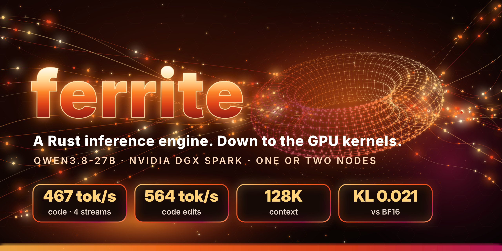
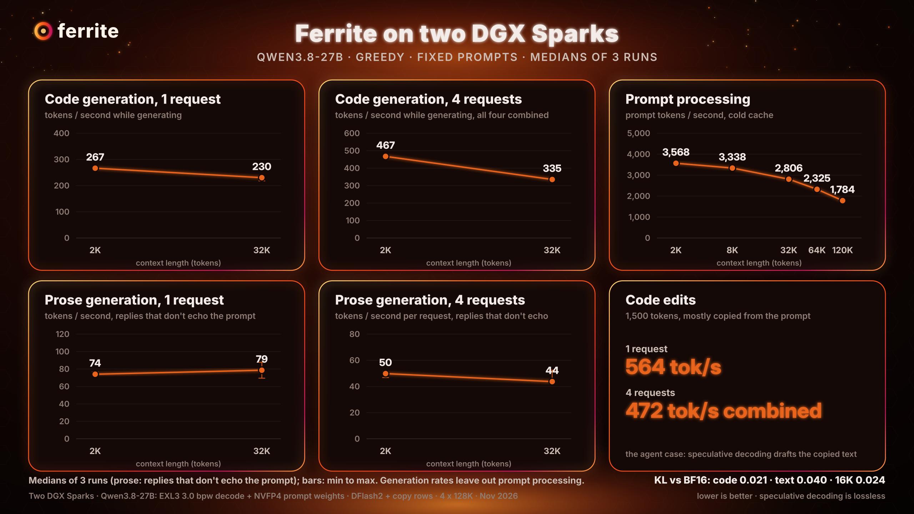

<p align="center"></p>

# Ferrite

**What it is.** Ferrite is a local LLM server written in Rust, from the HTTP server down to the GPU kernels. You run it
on your own machine and it serves a model behind an OpenAI-compatible API on port 8000.

**What it does.** It runs **four specific models on specific hardware** (the table below), each tuned for that
hardware: 128K-token contexts, streaming, reasoning ("thinking"), tool calls, and speculative decoding that makes
replies faster without changing a single token of them.

**Who it is for.**

- You own one of the machines in the table and want a fast local model for a coding agent or a chat client
  (Open WebUI, Continue, Cline, Pi and anything else that speaks the OpenAI API).
- You want to see how an inference engine works when all of it, including the GPU kernels, is Rust.

**Who it is not for.**

- You want to load any model you like. Ferrite serves only the models below, in the formats named in their guides.
- You are on macOS or Windows. Ferrite is **Linux only**.
- You need a hardened, multi-user service. There is no API key and no accounts: use it on a network you trust.
- You want a download that just runs. Ferrite ships **no prebuilt binaries**; every setup is built from source (one
  command on DGX Spark, a few commands elsewhere).

> **Status: experimental.** DGX Spark is the main target; every other row of the table is marked experimental in its
> guide and was developed and measured on one machine. It works, but expect rough edges. Issues and measurements from
> other machines are welcome.

## What runs where

Find your hardware, then follow that row's guide. Speeds are generated tokens per second for one code request at a
short context with the launcher's defaults. The test differs a little from row to row (the guide says exactly which),
and each guide has the full tables, the long-context figures and how they were measured.

| Model | Hardware | Code, tokens/s | Requests at once | Guide |
|---|---|---|---|---|
| **Qwen3.8-27B** | One NVIDIA DGX Spark | 167; 287 in total with 4 requests | 4 | [docs/quickstart.md](docs/quickstart.md) |
| Qwen3.8-27B | Two NVIDIA DGX Spark | 267; 467 in total with 4 requests | 4 | [docs/quickstart.md](docs/quickstart.md#two-nodes-tp2), [TP2.md](TP2.md) |
| Qwen3.8-27B | One RTX 5080 (16 GB) | 298 | 1, up to 4 | [docs/rtx-5080.md](docs/rtx-5080.md) |
| Qwen3.8-27B | One RTX 5060 Ti (16 GB) | 157 | 1, up to 4 | [docs/rtx-5080.md](docs/rtx-5080.md#on-an-rtx-5060-ti-16-gb) |
| Qwen3.8-27B | One RTX PRO 4000 Blackwell (24 GB) | 200 | 1, up to 4 | [docs/rtx-pro-4000.md](docs/rtx-pro-4000.md) |
| Qwen3.8-27B | One Intel Arc Pro B70 (32 GB), **no longer maintained** | 170 (measured with 0.6.0) | 1, up to 4 | [docs/arc-b70.md](docs/arc-b70.md) |
| **Qwen3.8-Flash-Next** | One or two RTX 5060 Ti (16 GB), 32 GB of host memory | 93-99 (one card), 131-146 (two) | 1 to 4, by host memory | [docs/flash-next.md](docs/flash-next.md) |
| **DeepSeek-V4.1-Flash Coder** | Three 24 GB cards, optionally a fourth of 16 GB | 103 (three cards), 114 (four) | 1, up to 4 | [docs/deepseek-coder.md](docs/deepseek-coder.md) |
| **Inkling-2-Mini** | One RTX PRO 4000 Blackwell (24 GB) or one RTX 5060 Ti (16 GB) | 138 (24 GB), 110 (16 GB) | 1 | [docs/inkling-2-mini.md](docs/inkling-2-mini.md) |

- **The Intel Arc Pro B70 row is no longer maintained.** The test card is gone, so that engine is not built or tested
  on later versions; the last one run on the card is 0.7.1. Its code, guide and model stay available
  ([docs/arc-b70.md](docs/arc-b70.md)).
- Every row serves a context of up to 128K tokens (131,072).
- **Qwen3.8-Flash-Next and DeepSeek-V4.1-Flash Coder are run from quants made for code.** They are for coding work and
  are weak at general chat; their guides say what was seen.
- "1, up to 4" means one request at a time by default and up to four when you ask for more slots; further requests
  wait in a queue. Inkling-2-Mini serves one request at a time and is text only.
- Each model is a separate engine inside the same server, `fe-server`. You build the engine for your row
  ([Build, download, start](#build-download-start)).
- Operating systems, drivers and memory for each row are under [Requirements](#requirements).

## What you get

- **An OpenAI-compatible API** at `http://<your machine>:8000/v1`: `/v1/chat/completions`, `/v1/completions`,
  `/v1/models` and `/health`, with streaming, reasoning and tool calls.
- **Speed from speculative decoding that is lossless.** A small draft proposes the next few tokens and the model checks
  them in one pass. The reply is the same text you would get without drafting; only the time changes. Code and edits
  gain the most, prose the least.
- **Long contexts on small cards.** Where a model does not fit on the card, Ferrite keeps part of it in host memory
  and stores the attention cache compactly; each guide says what that costs.
- **Measured accuracy.** The Qwen3.8-27B and Inkling-2-Mini guides report how far Ferrite's output distribution is
  from the original model's (KL divergence) for the formats it runs. For Qwen3.8-Flash-Next and DeepSeek-V4.1-Flash
  Coder that has not been measured; their guides say what is checked instead.
- **Settings that suit coding agents.** Sampling defaults come from each model's publisher, a `temperature: 0`
  request stays on the fast path, and the settings tested with the Pi agent are in [docs/harness.md](docs/harness.md).

## Build, download, start

Every setup is the same three steps: build the engine for your row, download its model files, start its launcher.
Each guide has the commands for its row, with the folder to set and the disk space needed. On DGX Spark,
[one command](#quick-start-dgx-spark) does all three.

| Setup | Build | Download | Start |
|---|---|---|---|
| Qwen3.8-27B on DGX Spark | `cargo build --release -p fe-server --features ferrite -p fe-cli` | `scripts/fetch-models.sh` | `scripts/serve.sh` (two Sparks: `tools/serve-tp2.sh`) |
| Qwen3.8-27B on RTX 5080, RTX 5060 Ti or RTX PRO 4000 | `FE_KARCH=sm_120a cargo build --release -p fe-server --features ferrite -p fe-cli` | `scripts/fetch-models.sh quant prompt` | `scripts/serve.sh` (it picks the card's preset: `tools/serve-5080.sh` or `tools/serve-pro4000.sh`) |
| Qwen3.8-27B on Arc Pro B70 | `cargo build --release --features xe -p fe-server` | `scripts/fetch-models.sh xq draft` | `scripts/serve-xe.sh` |
| Qwen3.8-Flash-Next | `FE_KARCH=sm_120a cargo build --release -p fe-server --features ferrite,fnext` | `scripts/fetch-flashnext.sh` | `tools/serve-fnext.sh` |
| DeepSeek-V4.1-Flash Coder | `cargo build --release -p fe-server --features dsc -p fe-dsc` | `scripts/fetch-deepseek.sh` | `tools/serve-dsc.sh` |
| Inkling-2-Mini | `FE_KARCH=sm_120a cargo build --release -p fe-server --features ink -p fe-ink` | `scripts/fetch-inkling.sh` | `tools/serve-ink.sh` |

- `FE_KARCH` names the card the GPU kernels are built for. It is needed only when the build machine does not hold
  that card: without it the build uses the card `nvidia-smi` reports.
- `scripts/check-deps.sh --build --install` checks the machine and installs the Rust toolchains before the build;
  what a clean machine needs is under [Building from source](#building-from-source).
- `scripts/` holds what you run to install, download and serve the main model (`install.sh`, `fetch-*.sh`,
  `serve.sh`, and `ferritectl.sh`, which runs a server in the background, with `status`, `log` and `stop`; it covers
  every setup except DeepSeek Coder and Inkling-2-Mini, whose launchers run in the foreground). `tools/` holds the launchers of the other engines and
  presets, the benchmark clients (`tools/bench`) and the API checks (`tools/conformance`). `tools/serve.sh` is
  `scripts/serve.sh` with short setting names.
- Every launcher takes `--help`, runs in the foreground (Ctrl-C stops it) and serves on port 8000.

> **Network access.** Every Ferrite launcher listens on all interfaces (`0.0.0.0`) by default, so other machines on
> your local network (a laptop running a coding agent, say) can use the server. There is no API key: use it on a
> trusted network or firewall the port. `FERRITE_HOST=127.0.0.1` keeps a server on its own machine.

Point any OpenAI-compatible client at `http://<your machine>:8000/v1`.

## Requirements

**Linux only.** macOS and Windows are not supported.

| Setup | Operating system | CPU | GPU and driver | How you get it |
|---|---|---|---|---|
| NVIDIA DGX Spark, one or two | DGX OS (Ubuntu 24.04) | aarch64 | GB10, NVIDIA driver 580+, CUDA 13 | From source |
| NVIDIA RTX 5080 or RTX 5060 Ti 16 GB (experimental) | Linux; tested on Ubuntu 24.04 | x86_64 | 16 GB, NVIDIA driver 580 or later (tested 595.99), CUDA 13 `ptxas` and cuBLASLt | From source: [docs/rtx-5080.md](docs/rtx-5080.md) |
| NVIDIA RTX PRO 4000 Blackwell 24 GB (experimental) | Linux; tested on Ubuntu 24.04 | x86_64 | 24 GB, NVIDIA driver 580 or later (tested 595.99), CUDA 13 `ptxas` and cuBLASLt | From source: [docs/rtx-pro-4000.md](docs/rtx-pro-4000.md) |
| Qwen3.8-Flash-Next on RTX 5060 Ti, one or two (experimental) | Linux; tested on Ubuntu 24.04 | x86_64 | 16 GB, NVIDIA driver 580 or later (tested 595.99), CUDA 13 `ptxas`; 32 GB of memory | From source: [docs/flash-next.md](docs/flash-next.md) |
| DeepSeek-V4.1-Flash Coder on three 24 GB cards, plus an optional fourth of 16 GB (experimental) | Linux; tested on Ubuntu 24.04 | x86_64 | tested on RTX PRO 4000 Blackwell (+ RTX 5060 Ti), NVIDIA driver 580 or later, CUDA 13 `ptxas`; tested with 128 GB of memory, ~191 GB of SSD for the files | From source: [docs/deepseek-coder.md](docs/deepseek-coder.md) |
| Inkling-2-Mini on one RTX PRO 4000 Blackwell 24 GB or one RTX 5060 Ti 16 GB (experimental; text only, one request at a time) | Linux; tested on Ubuntu 24.04 | x86_64 | 16 GB or 24 GB, NVIDIA driver 580 or later (tested 595.99), CUDA 13 `ptxas`; 32 GB of host memory on the 16 GB card | From source: [docs/inkling-2-mini.md](docs/inkling-2-mini.md) |
| Intel Arc Pro B70 (no longer maintained, last tested with 0.7.1) | Linux with the `xe` kernel driver; tested on Arch Linux | x86_64 | 32 GB, Level Zero loader 1.32+ | From source: [docs/arc-b70.md](docs/arc-b70.md) |

## Results

These are the figures for **two DGX Sparks**. One Spark runs at about 60% of them (code 167 tokens/s for one request,
287 for four: [docs/benchmarks.md](docs/benchmarks.md)). The figures for every other row of
[What runs where](#what-runs-where) are in its guide.

- Setup: two DGX Sparks connected over RoCE, Qwen3.8-27B, `tools/serve-tp2.sh` defaults, greedy decoding, fixed prompts.
- Medians of 3-5 runs, in tokens per second. Measured 2026-11-15 with Ferrite 0.6.1 and not re-measured since.
- Generation figures are tokens per second while generating; prompt processing is listed separately. End-to-end
  figures that include the time to the first token are in [docs/benchmarks.md](docs/benchmarks.md#results).

| | Ferrite |
|---|---|
| Code, 4 requests (aggregate) | 467 |
| Code, 1 request | 267 |
| Code, 1 request, 32K context | 230 |
| Code edits, 1 request (rewrite a file it was shown) | 564 |
| Code edits, 4 requests (aggregate) | 472 |
| Prose, 1 request | 74 |
| Prompt processing, 2K / 32K context | ~3,550 / ~2,800 |
| KL divergence vs BF16 (code / text / 16K context), lower is better | 0.021 / 0.040 / 0.024 |

<p align="center"></p>

How these were measured, and what they leave out, is in [docs/benchmarks.md](docs/benchmarks.md). To reproduce the
table on your own two Sparks, start the server (`tools/serve-tp2.sh`) and run
`python3 tools/bench/sweep.py --url http://127.0.0.1:8000/v1 --out sweep` (about 20 minutes); `tools/bench/sweep.sh`
does both. What these figures leave out:
- Speculative decoding speed depends on the text. Code and edits are faster than prose.
- The prose figure counts only replies that don't fall into echoing the prompt, which the standard benchmark prose
  prompt tends to cause.

### Agents and the prompt cache

Coding agents resend the whole conversation every turn, and several agents often share one long system prompt.
Ferrite's prompt cache snapshots each conversation at turn boundaries and resumes from the longest match. A
conversation that loses its slot is parked in a memory pool, and a shared system prompt is computed once. A resumed
reply is the same, token for token, as one computed in full. The cache is on by default; `FERRITE_CACHE=0` turns it off.
Its pool is 12 GB on one Spark and 24 GB on each of two (`FERRITE_PARK_GB` overrides), and it shrinks if needed to keep
20 GB of memory available.

Four agents at once on two Sparks, sharing a ~13K-token system prompt (`tools/bench/agents.py --agents 4`, 2-3 turns
each), with the cache on instead of off (`FERRITE_CACHE=0`):
- prompt tokens computed: 84% fewer (86% fewer with thinking on);
- time to the first token on the first turn: 14.7 s to 5.0 s; on later turns about 0.3-1.0 s instead of 10 s;
- combined output over the run: 33.8 to 101 tok/s (thinking on: 41.1 to 113 tok/s).

How it works and its limits: [docs/prompt-cache.md](docs/prompt-cache.md).

**Coding agents.** The server fills the sampling fields a client leaves out from the model's published settings,
keeps a `temperature: 0` request on the fast greedy path, closes a runaway reasoning block, cuts loops short and
enforces `tool_choice`. Tested harness settings are in [docs/harness.md](docs/harness.md); the API checks behind
them are a standalone suite, [tools/conformance](tools/conformance/README.md).

## Quick start: DGX Spark

This section is for DGX Spark. On other hardware, follow your row's guide in [What runs where](#what-runs-where).

Requirements: a DGX Spark (GB10) with DGX OS, NVIDIA driver 580+, at least 95 GB of available memory and 45 GB of
free disk (about 38 GB of it for the models).

**One command**, from a fresh Spark to a running server. It checks the machine first, needs no `sudo`, and can be run
again (finished steps are skipped):

```bash
curl -fsSL https://raw.githubusercontent.com/BHCC2025/ferrite/main/scripts/install.sh | bash
```

It builds the latest release from source into `~/ferrite` (`FERRITE_HOME`; `--version 0.9.3` pins one; a few minutes
the first time: rustup, the pinned toolchains, `cargo build`) and puts the models into
`/var/tmp/models` (`FERRITE_MODELS`). It starts the server in the background (log `~/ferrite/logs/server-8000.log`;
stop it with `~/ferrite/scripts/ferritectl.sh stop`) and sends it a test request. `--no-serve` stops after the
models. Run again over an older release, the same command upgrades it. Ferrite ships no prebuilt binaries.

> **Install with your AI agent.** Paste this into your coding agent on the Spark:
>
> `Install Ferrite on this DGX Spark by following https://github.com/BHCC2025/ferrite/blob/main/AGENTS.md exactly; stop and ask me if any check fails.`

**Step by step** from source:

```bash
# 1. clone and build (scripts/check-deps.sh --build --install sets up rustup and the pinned toolchains)
git clone https://github.com/BHCC2025/ferrite.git && cd ferrite
scripts/check-deps.sh --build --install
cargo build --release -p fe-server --features ferrite -p fe-cli

# 2. download the models (about 38 GB) into $FERRITE_MODELS
export FERRITE_MODELS=$HOME/models    # set it in every shell you start the server from; the default is /var/tmp/models
scripts/fetch-models.sh

# 3. serve an OpenAI-compatible API on :8000 (model id "qwen3.8-27b"), in the foreground (Ctrl-C stops it)
scripts/serve.sh                      # or in the background: scripts/ferritectl.sh start | status | log | stop
curl -s localhost:8000/v1/models
```

The repository holds every launcher, the benchmark clients (`tools/bench`), the conformance suite
(`tools/conformance`) and all of `docs/`.

Point any OpenAI-compatible client at `http://<spark>:8000/v1`: Open WebUI, Continue, Cline and other coding agents.
Details, the two-Spark setup and troubleshooting are in [docs/quickstart.md](docs/quickstart.md) and [TP2.md](TP2.md).

### Models (Qwen3.8-27B on DGX Spark)

| Role | Repository | License |
|---|---|---|
| Decode weights: EXL3 mixed 3.0 bpw (5-bit head) | [`BHCC2025/Qwen3.8-27B-EXL3-3.0bpw-mix`](docs/model-card.md) | Apache-2.0 |
| Prompt weights: NVFP4/FP8 (optional) | [`nvidia/Qwen3.8-27B-NVFP4`](https://huggingface.co/nvidia/Qwen3.8-27B-NVFP4) | Apache-2.0 |
| Draft model: DFlash2 | [`z-lab/Qwen3.8-27B-DFlash2`](https://huggingface.co/z-lab/Qwen3.8-27B-DFlash2) | Apache-2.0 |

All three derive from [Qwen/Qwen3.8-27B](https://huggingface.co/Qwen/Qwen3.8-27B) (Apache-2.0). Without the NVIDIA
checkpoint, Ferrite processes prompts with bf16 weights rebuilt from the EXL3 quant. That runs at about half the
prompt speed, uses more memory, and defaults to 32K context.

### Configuration (Qwen3.8-27B launchers)

Everything has a default; set only what differs on your machines. `tools/site.sh` prints the resolved settings.
These are the settings of your site; the server settings (prompt weights, drafting, the prompt cache) are in
[docs/quickstart.md](docs/quickstart.md).

| Variable | Default | What it sets |
|---|---|---|
| `FERRITE_MODELS` | `/var/tmp/models` | Folder holding the three model folders |
| `FERRITE_EXL3_DIR` / `FERRITE_NVFP4_DIR` / `FERRITE_DRAFT_DIR` | under `$FERRITE_MODELS` | Each model folder, if stored elsewhere |
| `FERRITE_MODEL_ID` | `qwen3.8-27b` | Model id the API reports |
| `FERRITE_HOST` | `0.0.0.0` | Listen address of every launcher; `127.0.0.1` keeps the server on its machine (there is no API key) |
| `FERRITE_PORT`, `FERRITE_CTX`, `FERRITE_SLOTS` | `8000`, `131072`, `4` | Port, context per request, requests at once (at most 4 with DFlash2) |
| `FERRITE_GPU_LOCK` | `/var/tmp/ferrite-gpu.lock` | The node's GPU lock: a server holds it shared, plus its own card's lock (`ferrite-gpu.<card UUID>.lock`) exclusively, so servers on different cards run side by side |
| `FERRITE_LOCK_WAIT`, `FERRITE_FORCE` | `0`, `0` | `1`: wait for a held GPU lock instead of stopping; start despite a failed memory or model-file check |
| `FERRITE_STATE_DIR` | `/var/tmp/ferrite` | Logs, run files and locks |
| `FERRITE_PEER` | none | Second Spark's ssh host (required in two-node mode) |
| `FERRITE_FABRIC` | unset | `auto` detects the RoCE devices, interface and GID shared with the peer; the two-node scripts do this whenever `FERRITE_TP_HOST` is unset |
| `FERRITE_TP_HOST`, `FERRITE_NET_IF`, `FERRITE_ROCE_HCA`, `FERRITE_ROCE_GID` | see TP2.md | Manual two-node fabric settings |

## How it gets its speed

Qwen3.8-27B on DGX Spark; each guide describes what its own engine does.

- **EXL3 decode** at about 90% of GB10's memory bandwidth. Matrix-vector kernels batch up to 48 rows into one weight
  decode, and every row stays bit-identical to single-row decoding.
- **NVFP4 prompt processing** through block-scaled tensor-core GEMMs written in Rust.
- **Lossless speculative decoding:**
  - DFlash2 block drafting with best-first verify trees;
  - copy rows, which propose the continuation of earlier text and pay off most on code edits;
  - the model's MTP head as a fallback.
- **Two Sparks over RoCE.** The model is split across both nodes, with small reductions over RDMA through a Rust
  proxy kernel and NCCL for large prompt batches.
- **Batch invariance.** A request's output does not depend on what else is running, and speculation never changes the
  text. Both are checked before every merge.
- **A prompt cache for agents.** Turn snapshots, parked conversations and a shared system prompt, with resumed
  replies identical to recomputed ones ([docs/prompt-cache.md](docs/prompt-cache.md)).

## What is Rust and what is not

Rust: every GPU kernel, the CUDA driver bindings, the model and scheduler, speculative decoding, the two-node fabric
(RDMA over libibverbs), tokenizer and HTTP server. Not Rust: NVIDIA's `ptxas` assembler (build time), the CUDA driver
itself, libibverbs, and NCCL for two-node prompt batches; on Intel Arc, the SPIR-V translator (build time), Intel's
device compiler and the Level Zero loader. [NON-RUST.md](NON-RUST.md) lists every non-Rust part, why it is there and whether a replacement is planned.

## Words used in these docs

| Term | Meaning |
|---|---|
| Token, tokens/s | Models read and write text in pieces called tokens (about three quarters of a word). Speed is tokens per second. |
| Context | The text a request can hold: the prompt plus the reply. 128K is 131,072 tokens. |
| Prompt processing (prefill) | Reading the prompt before the first reply token appears. Listed separately from generation speed. |
| Decode, plain decoding | Generating the reply, one token per pass of the model when there is no drafting. |
| Speculative decoding, drafting | A cheap draft proposes several tokens and the model checks them in one pass. Ferrite's is lossless: the text is the same as without it. |
| Draft model, draft head, MTP, DFlash2, copy rows | The sources of drafts: a small separate model (DFlash2, DSpark), a head that ships with the model (MTP), or text copied from earlier in the conversation (copy rows, which pay off on code edits). |
| K/V cache | What attention keeps for every token of the context. It grows with the context, so Ferrite stores it at 6 bits on small cards. |
| Quant, bpw | A model stored with fewer bits per weight (bpw) so it fits. EXL3, NVFP4, MXFP8 and GGUF IQ are the formats Ferrite reads. |
| KL divergence | How far the next-token probabilities are from the original model's. 0 is identical; the guides report the measured value. |
| Experts (MoE) | Some models hold many small sub-networks and use a few per token. Ferrite can keep rarely used ones in host memory. |
| Slots, requests at once | How many requests the server works on together; more wait in a queue. |
| TP2 | Two DGX Sparks working as one server over the cable between them (RoCE). |
| Prompt cache | Keeps what the server computed for a conversation so the next turn does not recompute it. |
| Kernel | A small program that runs on the GPU. Ferrite's are written in Rust. |
| Engine, `fe-server`, launcher | `fe-server` is the server program. An engine is the part of it that runs one model family; you choose engines when you build. A launcher is the script that starts `fe-server` with the right settings for your hardware. |
| BF16 | The original model's 16-bit weights, before any quant. Accuracy is measured against it. |
| Greedy decoding, sampling | Greedy (`temperature: 0`) always takes the most likely token, so a reply is repeatable. Sampling picks among likely tokens. |
| Verify rows, verify tree | The drafted tokens the model checks in one pass, and the tree of alternative drafts they form. |
| Time to first token | The wait before the reply starts: mostly prompt processing. |
| Clean reply, echo | Some prose benchmark prompts make a model repeat the prompt (an echo). Prose speeds count only replies that do not (clean). |
| GDN (Gated DeltaNet) | The layer type most of Qwen3.8 is made of. It keeps a small running state instead of looking back over the whole context. |
| Host memory, device memory | The computer's RAM, and the memory on the graphics card. Pinned host memory is RAM locked in place so the card can read it quickly. |
| `sm_120a`, `sm_121a`, `FE_KARCH` | The GPU architecture the kernels are built for: `sm_121a` on DGX Spark, `sm_120a` on the RTX cards. |

## Building from source

Needs stable Rust 1.99+, the kernels' pinned nightly (`nightly-2026-11-04`, in `kernels/rust-toolchain.toml`) with
`rust-src`, `llvm-tools` and `llvm-bitcode-linker` for the `nvptx64-nvidia-cuda` target, CUDA 13's `ptxas` and, for
the 27B engine, cuBLASLt. A clean Ubuntu also needs `curl ca-certificates git build-essential python3 python3-venv`;
[docs/quickstart.md](docs/quickstart.md#clean-machine) has the commands, including NVIDIA's repository for `ptxas`
(`cuda-nvcc-13-x`, no full toolkit) and the `FE_KARCH` of each card. `scripts/check-deps.sh --build --install`
checks them and installs the Rust toolchains; then `cargo build --release -p fe-server --features ferrite -p fe-cli`.
See [docs/quickstart.md](docs/quickstart.md#build-from-source). The Intel Arc build needs neither CUDA nor `ptxas`; its
tools are listed in [docs/arc-b70.md](docs/arc-b70.md#requirements).

## Why Ferrite exists

Ferrite started as an experiment by a [TensorFold](https://github.com/ashhart/TensorFold) contributor: how far down the
stack can Rust go in a real inference engine, all the way into the GPU kernels, and what does it cost? Much of what
makes Ferrite work was learned from TensorFold and exllamav3 first (see [Credits](#credits)). If you want a mature
engine that serves many models, use TensorFold. Ferrite is a focused look at the Rust question:
a few models, each tuned for particular hardware.

## Credits

Ferrite stands on a lot of other people's work, and [CREDITS.md](CREDITS.md) lists every project and paper it drew on
and exactly what it took from each. The largest debts:
- [TensorFold](https://github.com/ashhart/TensorFold): Ferrite grew out of work on TensorFold. Its kernel designs,
  the hybrid of NVFP4 prompt processing with EXL3 decode, the DFlash2 verify tree and copy rows all came from there,
  as did much of the two-Spark approach.
- [exllamav3](https://github.com/turboderp-org/exllamav3): the EXL3 format, its kernels and the quantization tools,
  plus the QTIP trellis quantization it builds on.
- DFlash2 by z-lab and inco.ai, the draft model behind the speculative decoding.
- Qwen3.8 by the Qwen team.
- NVIDIA's NVFP4 checkpoint and Model Optimizer.

## License

Apache-2.0. See [LICENSE](LICENSE) and [NOTICE](NOTICE).